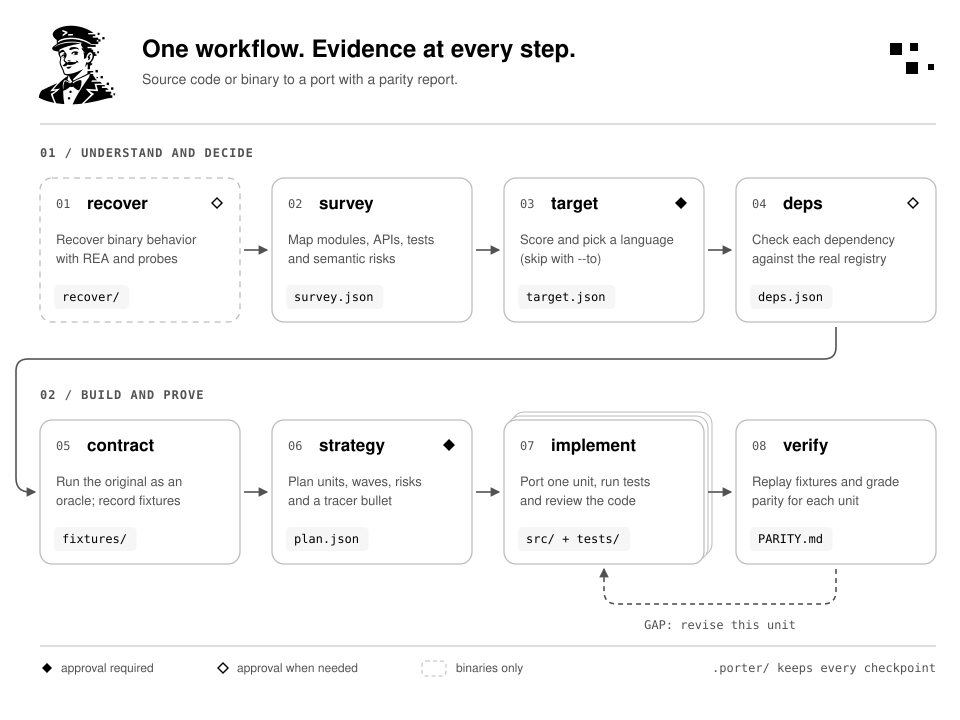

<p align="center">
  <picture>
    <source media="(prefers-color-scheme: dark)" srcset="assets/logo-dark.svg">
    
  </picture>
</p>

<p align="center">
  Port libraries, CLI tools and binaries to another language, and prove the port behaves like the original.
</p>

<p align="center">
  <a href="https://github.com/WebEferen/AgentPorter/actions/workflows/ci.yml"></a>
  <a href="LICENSE"></a>
  
  
  
</p>

AgentPorter is a plugin for Claude Code and Codex. It moves a library, package or CLI tool from one
language to another in phases that leave evidence behind: a survey of the source, a decision for every
dependency checked against the real package registry, fixtures recorded from the original, a plan cut
into small units, and a parity report that compares the port with the original case by case.

It also works without source code. Point it at a compiled binary or a closed tool and it reverse
engineers the observable behavior with [REA](https://github.com/morluto/rea) first, then recommends a
target language if you have not picked one.

It does not port UI, whole applications with databases and deployment, or timing-sensitive concurrency.
When something cannot be proven, the parity report says so instead of hiding it.

## Install

```sh
curl -fsSL https://raw.githubusercontent.com/WebEferen/AgentPorter/main/install.sh | sh
```

This installs the plugin for Claude Code and Codex, whichever is on your PATH, and the `agentporter`
CLI. Run it again to update. Options go after `sh -s --`: `--no-claude`, `--no-codex`, `--no-cli` or
`--ref <tag>`. The plugin needs Python 3.11 or newer as `python3`.

<details>
<summary>Install by hand</summary>

Claude Code, from inside a session:

```text
/plugin marketplace add WebEferen/AgentPorter
/plugin install agentporter@agentporter
```

Codex:

```text
codex plugin marketplace add WebEferen/AgentPorter
codex plugin add agentporter@agentporter
```

The CLI on its own, for CI or scripting (no dependencies):

```text
pipx install git+https://github.com/WebEferen/AgentPorter
agentporter --help
```

Other agents that read the skills folder layout can copy or symlink `skills/*`. Details for each path
are in [docs/installing.md](docs/installing.md).

</details>

## Quick start

Create an empty repository for the port, open your agent there and point it at the source:

```text
mkdir slugify-ts && cd slugify-ts && git init
claude
> /agentporter:port https://github.com/un33k/python-slugify --ref v9.1.3 --to typescript
```

Without `--to`, the target phase recommends a language and asks you to pick one. For a binary with no
source:

```text
> /agentporter:port ./bin/gron
```

The router asks who authorized the analysis, records the answer, runs REA, and continues from the
recovered behavior.

Calling `/agentporter:port` with no arguments resumes the current port.

## Examples

Five small libraries ported end to end, each in one unattended session. Every folder holds the original
at its pinned commit next to the port, with the full `.porter/` workspace and the parity report.

| Example | Direction | Level | Fixtures exact | Reference tests |
| --- | --- | --- | --- | --- |
| [ms-to-go](examples/ms-to-go/) | JavaScript to Go | DIVERGENT | 1458 of 1490 | 44 of 49 |
| [shellquote-to-python](examples/shellquote-to-python/) | Go to Python | EXACT | 1083 of 1083 | 29 of 29 |
| [scule-to-go](examples/scule-to-go/) | TypeScript to Go | EXACT | 2984 of 2984 | 63 of 63 |
| [compare-versions-to-rust](examples/compare-versions-to-rust/) | TypeScript to Rust | DIVERGENT | 4239 of 4288 | 406 of 422 |
| [humps-to-rust](examples/humps-to-rust/) | Python to Rust | DIVERGENT | 4625 of 4627 | 18 of 18 |

No case fails in any of them; the divergent ones are listed with reasons. Each run cost $15 to $23. How
they were made, and what that means for the results: [examples/README.md](examples/README.md).

## How it works

<picture>
  <source media="(prefers-color-scheme: dark)" srcset="assets/how-it-works-dark.svg">
  
</picture>

| Phase | What happens | You approve |
| --- | --- | --- |
| recover | Artifact mode only. REA and black-box probes recover the CLI surface, embedded module metadata and dependencies. | when evidence is weak or nothing is runnable |
| survey | Languages, modules, public API, entry points, tests, risk signals such as reflection, regex, float formatting. | |
| target | Scores candidate languages on ecosystem fit, dependency coverage, semantic distance, runtime fit, team and tooling. Skipped when you pass `--to`. | always |
| deps | Every dependency gets one of seven decisions, each backed by a registry lookup. | when something needs your call |
| contract | Public API in a neutral format, and fixtures recorded by running the original as an oracle. | |
| strategy | Units, layers, waves, a tracer bullet, idiom map, risks and budgets. Nothing is written to your code before this gate. | always |
| implement | One unit at a time: scaffold, code, port tests, wire fixtures, green build, independent review. | when a unit gets blocked |
| verify | Runs the same fixtures against the port and grades each unit EXACT, EQUIVALENT, DIVERGENT, ASSERTED or GAP. | |

All state lives in a `.porter/` folder in the repository that will hold the port. A port can stop and
resume across sessions, models and people. `/agentporter:status` shows where it stands at any time.

## Skills and agents

| Skill | Purpose |
| --- | --- |
| `/agentporter:port` | Router: starts a port, runs phases in order, stops at gates, resumes. |
| `/agentporter:recover` | Reverse engineers an artifact with REA and black-box probes. |
| `/agentporter:survey` | Maps the source: modules, API, entry points, tests, risk signals. |
| `/agentporter:target` | Scores target languages and records your choice. |
| `/agentporter:deps` | Resolves every dependency to a decision with registry evidence. |
| `/agentporter:contract` | Extracts the public contract and records oracle fixtures. |
| `/agentporter:strategy` | Decomposes the port into units and writes the plan. |
| `/agentporter:implement` | Implements the next unit through the full task checklist. |
| `/agentporter:verify` | Runs fixtures against the port and writes `PARITY.md`. |
| `/agentporter:status` | Read-only stage card and unit board. |

Seven subagents do the focused work: `surveyor`, `recoverer`, `scout` (registry research),
`contract-extractor`, `implementer`, `reviewer` and `verifier`. The reviewer and verifier never see the
implementer's reasoning, only the code, the contract and the fixtures.

## Dependency decisions

Each dependency of the source ends with exactly one decision:

| Decision | Meaning |
| --- | --- |
| ABSORB | The target standard library covers it. |
| MAP | A target package covers it. |
| SHIM | A package covers most of it and a thin adapter bridges the rest. |
| PORT | Small enough to port as part of this job, within the port budget. |
| VENDOR | Keep the original behind a binding (wasm, C ABI, subprocess). Last resort. |
| DROP | Not needed in the target, such as polyfills and source-only tooling. |
| DEFER | Out of scope for now, with a reason. |

MAP and SHIM candidates must pass a live registry lookup. `porter.py registry verify-deps` re-checks
every one of them, and the phase cannot finish while a candidate is unverified. PORT and VENDOR copy a
dependency's own code into the port, so verify-deps also checks that dependency's license and raises a
gate item when its terms do not fit the port's.

## Parity

The original runs as an oracle and its outputs become fixtures in `.porter/fixtures/`. The port runs the
same cases through a small harness, and `porter.py parity collect` compares both. An excerpt from the
`PARITY.md` of the [ms to Go example](examples/ms-to-go/port/PARITY.md):

```text
Upstream: ms 2.1.3 (javascript, commit 1c6264b79549).
Port: github.com/agentporter-examples/ms in go. Evidence date: 2026-10-20. Harness run: final.
Fixtures: 1490 cases, 1458 exact, 8 normalized, 24 divergent, 0 failed, 0 missing.

| Unit  | Level     | Fixtures (exact / normalized / divergent / failed of total) | Reference tests (pass / total) | Divergences               | Perf (median ratio) |
| index | DIVERGENT | 1458 / 8 / 24 / 0 of 1490                                   | 44 / 49                        | empty-string, typed-input | 0.022x              |
```

Intended differences are allowed when they are written down. Each one gets an entry in
`divergences.json` and a `DIVERGENCE(id)` marker in the code, and the report lists both. More in
[docs/parity.md](docs/parity.md).

## Reverse engineering with REA

In artifact mode the recover phase drives the [REA](https://github.com/morluto/rea) CLI
(`rea-agents` on npm) and runs the binary itself with `--help`, `--version` and similar probes. It
records Go and Rust build metadata, .NET and JVM members, Electron and JavaScript bundle sources, Android
packages and CLI help output as evidence in `.porter/recover/evidence/`. The survey and deps phases then
work from that evidence instead of source code.

Decompiled code is evidence only and never copied into the port. You need the right to analyze the
artifact, and the workspace records who granted it. See [docs/reverse-engineering.md](docs/reverse-engineering.md).

## Language support

Any source and target language can go through the pipeline. Reference material makes the result better:

| Kind | Coverage |
| --- | --- |
| Full pair references | Python to TypeScript, JavaScript to TypeScript, PHP to TypeScript, Java to Kotlin |
| Stub pair references | Python to Rust, Ruby to TypeScript, Go to Rust, C++ to Rust, Perl to Python |
| Ecosystem references | TypeScript, Python, Go, Rust, Java, Kotlin, PHP, Ruby, C#, Elixir |
| Oracle drivers | Python, JavaScript, Go, Java (also Kotlin), PHP, plus any CLI through `porter.py cli record` |
| Parity harnesses | TypeScript, Python, Go, Rust, Kotlin, plus any CLI through `porter.py cli run` |
| Registries checked | npm, PyPI, crates.io, Go proxy, Maven Central, Packagist, RubyGems, NuGet, Hex |

Pairs without a reference fall back to `knowledge/pairs/GENERIC.md`. Adding a pair is a single Markdown
file, described in [docs/adding-a-language-pair.md](docs/adding-a-language-pair.md).

## The `.porter/` workspace

```text
.porter/
  config.json, state.json       written only by porter.py
  decisions.md                  every gate decision, in your words
  recover/                      artifact mode: evidence, recovery.json, recovery.md
  survey.json, survey.md
  target.json, target.md
  deps.json, deps.md
  contract/                     api.json, contract.md, per-unit contracts
  oracle/, fixtures/            oracle driver and recorded cases
  plan.json, strategy.md, decomposition.md
  reports/units/                one report per unit
  parity.json, PARITY.md
  cache/, runs/                 git-ignored
```

Commit it with the port. It is the audit trail of how the port was made.

## Configuration

`porter.py init` writes `.porter/config.json`. The keys you are most likely to change:

| Key | Default | Effect |
| --- | --- | --- |
| `options.commitPolicy` | `per-unit` | Commit after each unit, or `never`. |
| `options.budgets.unitMaxLoc` | 400 | Source lines per unit before a split. |
| `options.budgets.unitMaxSymbols` | 8 | Public functions, classes and similar per unit. |
| `options.budgets.unitMinLoc` | 30 | Units below this merge into their only consumer. |
| `options.budgets.attemptsPerUnit` | 3 | Implementation attempts before a unit is BLOCKED. |
| `options.budgets.discoveredUnits` | 5 | Units added mid-implementation before AgentPorter stops and asks. |
| `options.budgets.portMaxLoc` | 2000 | Largest dependency the deps phase may decide to port. |
| `options.registryTtlHours` | 24 | Registry cache lifetime. |

How the units are cut is described in [docs/decomposition.md](docs/decomposition.md).

## The helper CLI

Every skill calls `scripts/porter.py`, a standard library Python tool that owns the state machine and
the deterministic parts: workspace state, registry lookups, dependency graphs, decomposition, fixture
expansion, CLI recording, parity scoring and REA runs. Installed with pipx it is the `agentporter`
command. The full reference is in [docs/cli.md](docs/cli.md).

```text
agentporter state board --units      # where the port stands
agentporter state next --json        # the single next action
agentporter parity collect --run ci  # exits 1 when a GAP remains
```

## Limits

- Parity is only as good as the fixtures. Code paths no fixture or reference test reaches are not proven.
- Code welded to the source runtime (metaclasses, reflection, ORMs, native extensions) gets a contract
  port with listed divergences, or is deferred.
- Performance is a sanity check against the oracle, not a guarantee.
- Artifact mode recovers behavior that can be observed. Internal logic that never shows up in output
  stays unknown, and recovery.md lists it as such.
- Registry lookups need network access. Cached results are reused, and the phase says when it ran
  offline.

## Contributing

Bug reports, language pairs, ecosystem references and evals are welcome. Start with
[CONTRIBUTING.md](CONTRIBUTING.md). Run the tests with:

```text
python3 -m unittest discover -s tests
```

Security issues go through GitHub private vulnerability reporting, described in [SECURITY.md](SECURITY.md).

## License and credits

MIT, see [LICENSE](LICENSE) and [NOTICE](NOTICE). Reverse engineering is done by [REA](https://github.com/morluto/rea), which is a
separate project with its own license and is downloaded on demand.
